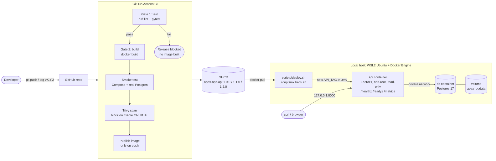

# Apex Operations API

A small API for tracking operational tasks, packaged and operated the way a production service would be: containerised, tested and scanned in CI, released as versioned images, deployed with Docker Compose, observable, and reversible with a one-command rollback.

**Author:** Ifeoma Jane Akabueze · **Assessment:** Junior DevOps Engineer, Apex AI Arabia
**AI assistance:** used and disclosed in [docs/AI_USE.md](docs/AI_USE.md)

---

## What is in this repository

| Requirement | Where | Evidence |
|---|---|---|
| 1. API in Docker, health/readiness, non-root | `app/`, `Dockerfile` | `evidence/01-container.txt` |
| 2. CI: install, lint, test, build, block on failure | `.github/workflows/ci.yml` | `evidence/04-ci-runs.txt`, `evidence/ci-failure-blocked.png` |
| 3. Compose: app + Postgres, env config, persistent storage | `compose.yaml`, `.env.example` | `evidence/02-compose-persistence.txt` |
| 4. Versioned release and executable rollback | `scripts/deploy.sh`, `scripts/rollback.sh` | `evidence/03-release-rollback.txt` |
| 5. Logs, health checks, metrics, alert proposal, failure investigation | `app/main.py`, `monitoring/alerts.yml`, `docs/OBSERVABILITY.md` | `evidence/05-db-outage-drill.txt` |
| 6. Secrets, least privilege, scanning, cloud cost path | `docs/SECURITY.md` | CI scan steps |
| Runbook | `docs/RUNBOOK.md` | |
| Decision memo | `docs/DECISION_MEMO.md` | |

## Architecture



```
developer ─▶ GitHub ─▶ CI: lint+tests ─▶ build ─▶ smoke test (real Postgres) ─▶ Trivy scan ─▶ publish to GHCR
                            │ fail
                            ▼
                      release blocked
GHCR ─▶ deploy.sh / rollback.sh ─▶ Docker Compose: api (non-root) ──private network──▶ postgres ─▶ volume
```

Source for the diagram: `docs/architecture.mmd` (Mermaid).

## API endpoints

| Endpoint | Purpose |
|---|---|
| `GET /healthz` | Liveness: the process is running. Never touches the database. |
| `GET /readyz` | Readiness: returns 200 if the database answers, 503 with `dependency: database` if not. |
| `GET /version` | The release that is running (baked into the image at build time). |
| `GET /metrics` | Prometheus metrics: request count by method/path/status, latency histogram. |
| `POST /tasks` | Create a task: `{"title": "...", "priority": "high"}` (priority: low, medium or high) |
| `GET /tasks`, `GET /tasks/{id}` | List or read tasks. |
| `POST /tasks/{id}/close` | Close a task (added in 1.1.0). |
| `GET /docs` | Interactive API documentation (FastAPI). |

## Prerequisites

- Linux, or Windows with WSL2 Ubuntu
- Docker Engine with the Compose plugin (`docker compose version`)
- Git; Python 3.13+ only if you want to run the tests outside Docker
- Free port 8000 on 127.0.0.1

## Run it (exact steps)

```bash
git clone https://github.com/Ifeoma-Obinna23/apex-ops-api.git
cd apex-ops-api

# 1. Create your private config and a random database password (never committed)
cp .env.example .env
sed -i "s/^POSTGRES_PASSWORD=.*/POSTGRES_PASSWORD=$(openssl rand -hex 16)/" .env
chmod 600 .env

# 2. Start the stack (pulls the CI-built image named by API_IMAGE:API_TAG in .env)
docker compose up -d --wait

# 3. Check it
curl -s localhost:8000/readyz      # {"status":"ready"}
curl -s localhost:8000/version     # {"version":"1.0.0"}
curl -s -X POST localhost:8000/tasks -H "Content-Type: application/json" \
     -d '{"title":"Rotate logs","priority":"high"}'
curl -s localhost:8000/tasks
```

Stop: `docker compose down` (data is kept in the `apex_pgdata` volume).
Delete everything including data: `docker compose down -v`.

## Run the tests

```bash
python3 -m venv .venv && source .venv/bin/activate
pip install -r requirements-dev.txt
ruff check app tests          # lint
pytest -v                     # 12 passed, 1 skipped
FAIL_DEMO=1 pytest -q         # the intentional failure: 1 failed
```

The tests use an in-memory store, so they need no database. CI additionally runs the built image against a real Postgres (smoke test).

**Automated checks (16 in total):** ruff lint · 12 pytest tests (liveness, readiness up, readiness 503 when the DB is down, create, read back, 404, two validation 422s, metrics, request ID, close task, unhandled error logged and counted) · intentional failure (switchable) · CI smoke test against real Postgres · Trivy scan gate.

## Release and rollback

A release is a Git tag. CI builds, tests, scans and publishes `ghcr.io/ifeoma-obinna23/apex-ops-api:<version>`.

```bash
git tag -a v1.2.0 -m "Release 1.2.0" && git push origin v1.2.0   # CI publishes 1.2.0
./scripts/deploy.sh 1.2.0      # pull, switch, verify; auto-rollback if checks fail
./scripts/rollback.sh          # back to the previous version (or: ./scripts/rollback.sh 1.0.0)
cat deploy.log                 # audit trail
```

Released versions: **1.0.0** (tasks API), **1.1.0** (close a task), **1.2.0** (unhandled errors logged and counted as 500; found during the outage drill).

Full procedures: [docs/RUNBOOK.md](docs/RUNBOOK.md).

## Repository layout

```
app/                 API source (main.py: endpoints, logging, metrics; store.py: Postgres + in-memory store)
tests/               pytest suite
scripts/             deploy.sh, rollback.sh
.github/workflows/   ci.yml
monitoring/          alerts.yml (proposed Prometheus alert rules)
docs/                runbook, decision memo, security, observability, AI use, diagram
evidence/            screenshots and captured terminal output
Dockerfile, compose.yaml, .env.example, requirements*.txt
```

## Assumptions

- "Local environment" means one machine running Docker Engine; no cloud resources were used.
- A tag push is the release approval. In a team this would be a protected tag or an approval step.
- Synthetic data only. No authentication on the API: it is bound to 127.0.0.1 and out of scope for this exercise (see the decision memo).
- Database schema changes are additive only, so any released version can run against the current data. This is what makes rollback safe.
